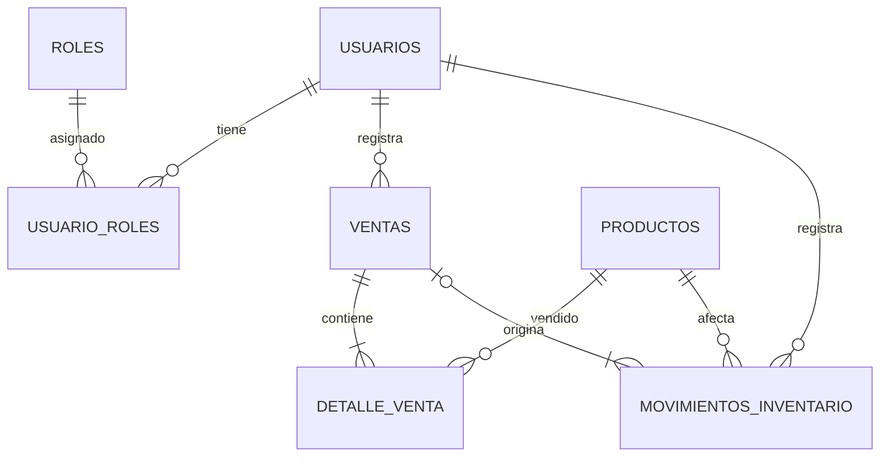

# Arquitectura y contratos

## Capas

`HTTP → Controller/DTO validado → Service @Transactional → Repository JPA → SQL Server`.

Las entidades no se serializan directamente en respuestas: se seleccionan campos en DTO/mapas para evitar ciclos y fugas de contraseña/costo. Los campos públicos de entidades simplifican esta base; evolucionar a métodos de dominio para encapsular mutaciones. `open-in-view=false` obliga a resolver relaciones dentro de transacciones.

Relaciones: Usuario N:M Rol; Usuario 1:N Venta y Movimiento; Venta 1:N DetalleVenta y Movimiento; Producto 1:N DetalleVenta y Movimiento. No se borran productos referenciados; se desactivan. Movimientos y detalles históricos no tienen endpoints de edición o borrado.

## Inventario y ventas

Las mutaciones usan bloqueo pesimista de Producto y control optimista `@Version`. Se bloquean productos en orden de ID al vender. El mismo bloqueo se usa para cambio de precios, baja y ajustes. Validar contra SQL Server real el SQL emitido y la política de aislamiento de la instalación; los deadlocks o conflictos requieren revisar el resultado antes de reintentar el cobro.

Dentro de una sola transacción se validan productos y stock, capturan precios y costos, crean venta y detalles, descuentan stock y registran movimientos. Una excepción revierte todo. No hay triggers de stock: sumar también desde un trigger duplicaría el movimiento. Los checks SQL impiden cantidades, precios o stock inválidos, pero la coherencia entre tablas depende de usar el servicio: restringir escritura directa y realizar conciliaciones periódicas.

La actualización de stock de cada movimiento es `stockPosterior = stockAnterior + cantidad`, con verificación de rango. `COMPRA` y `DEVOLUCION_CLIENTE` positivas; `VENTA`, `MERMA` y `DEVOLUCION_PROVEEDOR` negativas; `AJUSTE` representa un delta no nulo. Un retorno desde un proveedor se expresa como entrada de compra; devolución *al* proveedor como salida. No se aceptan movimientos `VENTA` desde el endpoint manual.

Fechas almacenadas como `datetime2(6)` UTC sin offset. El reporte usa inicio inclusivo/fin exclusivo del día local `America/El_Salvador` convertidos a UTC. Índice por fecha permite consultar el intervalo sin aplicar funciones a la columna. Las ventas a pérdida son válidas y pueden producir ganancia negativa.

## API REST

| Método y ruta | Permiso | Cuerpo o resultado |
|---|---|---|
| POST `/api/auth/login` | Público | `{username,password}` → `{accessToken,expiresIn,roles}` |
| GET `/api/productos` | ADMIN/VENDEDOR | Catálogo activo; costo solo ADMIN |
| POST `/api/productos` | ADMIN | `{sku,nombre,descripcion,precioCompra,precioVenta,fotoUrl}` → ID |
| PUT `/api/productos/{id}` | ADMIN | Mismos campos; no permite modificar stock |
| DELETE `/api/productos/{id}` | ADMIN | Baja lógica |
| POST `/api/ventas` | ADMIN/VENDEDOR | `{lineas:[{productoId,cantidad}]}` → `{id,total}` confirmado por servidor |
| GET `/api/inventario/movimientos` | ADMIN | Últimos 200 movimientos |
| POST `/api/inventario/movimientos` | ADMIN | `{productoId,tipo,cantidad,motivo}` |
| GET `/api/reportes/ganancia?fecha=2026-10-15` | ADMIN | Ganancia bruta diaria |
| GET `/api/usuarios` | ADMIN | Usuarios sin hash |
| POST `/api/usuarios` | ADMIN | `{username,password,rol:"ADMIN" o "VENDEDOR"}` |
| PUT `/api/usuarios/{id}/activo?valor=false` | ADMIN | Desactivación; no permite desactivarse a sí mismo |

Los endpoints autenticados obtienen al actor del token; nunca reciben usuario, precios ni ganancias en el cuerpo de venta. 400 validación, 401 credenciales/token, 403 permiso, 404 producto, 409 stock o unicidad. Agregar envelopes de error y DTO tipado de respuesta en la siguiente iteración.

Ejemplo de venta: dos unidades con costo 2.50 y precio 4.00 → total 8.00, ganancia 3.00 y movimiento -2. Un cambio posterior de costo a 3.00 no modifica esa ganancia histórica.

## Frontend

Angular standalone con rutas lazy por funcionalidad, equivalente a módulos de dominio `auth`, `dashboard`, `pos`, `productos`, `inventario`. `core` centraliza HTTP y autenticación; Angular Material aporta estilos y botones. El POS ofrece búsqueda SKU/nombre y carrito; productos ofrece alta/edición/baja; inventario registra deltas auditados. Para lectura automática de escáneres, agregar foco y envío al recibir Enter. Foto se guarda como referencia; no hay servidor de archivos en esta fase.

Los tokens se guardan en signals en memoria. El interceptor añade Bearer solo a rutas locales `/api/` y cierra sesión ante 401. Un cambio de precio es visible en la siguiente consulta; para actualización espontánea de pantallas abiertas agregar SSE y revalidación de carrito antes de confirmar. El importe del navegador es estimado; el servidor es autoridad financiera.

## Criterios de integración antes de producción

1. Stock 1 y dos ventas concurrentes de 1: exactamente una confirmada; otra 409, sin stock negativo.
2. Forzar fallo insertando el movimiento: ninguna venta, detalle o cambio de stock debe persistir.
3. Vendedor: 403 en productos POST/PUT/DELETE, inventario, reportes y usuarios; ningún costo en GET productos.
4. Token vencido, emisor o firma distintos: 401. Usuario desactivado: 401 aun con token vigente.
5. Venta a las 05:59:59 UTC pertenece al día local anterior; 06:00:00 al actual.
6. Intentar SKU duplicado, stock negativo o cantidad cero en SQL: rechazo por restricciones.
7. Precio modificado después de venta: ganancia histórica permanece igual.

Evolución sugerida: migraciones Flyway versionadas, pruebas Testcontainers SQL Server, idempotencia, recibos y reversos financieros, paginación, UI de usuarios y roles, auditoría de cambios de precio, HTTPS, rate limiting y respaldos probados. No añadir una segunda vía de actualización de stock.

## Papelería: catálogo, servicios y ventas

La ampliación 004 permite distinguir artículos de servicios, clasificar por categoría y marca, configurar unidad, ubicación y stock mínimo, y consultar el historial de cobros. `GET /api/ventas?fecha=AAAA-MM-DD&pagina=0` devuelve 20 registros por página y los totales del día. Administradores consultan el negocio y vendedores su propia actividad. `GET /api/ventas/{id}` recupera un comprobante sin costos ni ganancias.

`POST /api/ventas` acepta líneas, observaciones, medio de pago, importe recibido, total esperado, cliente y referencia opcionales, y `solicitudId` UUID. El frontend siempre envía un UUID y total esperado. Se bloquea el usuario antes de consultar la solicitud; una repetición con el mismo contenido devuelve la venta existente y una repetición con contenido distinto se rechaza. Un índice único `(usuario_id, solicitud_id)` refuerza la regla en SQL Server. Los productos se bloquean por ID en orden consistente. Artículos y servicios comparten cálculo monetario con BigDecimal; solo los artículos generan salidas de inventario. El pago, detalle, ganancias y movimientos se guardan en una sola transacción.

`GET /api/ventas/solicitud/{uuid}` consulta una operación pendiente de la propia cuenta y usa el mismo orden de bloqueo. Las ventas nuevas conservan nombre y SKU además de los precios históricos. Los registros antiguos no se rellenan con medios de pago inventados. La compatibilidad del POST antiguo, que solo enviaba líneas, se mantiene como efectivo exacto; esos clientes deben incorporar el UUID para obtener protección frente a reintentos.
